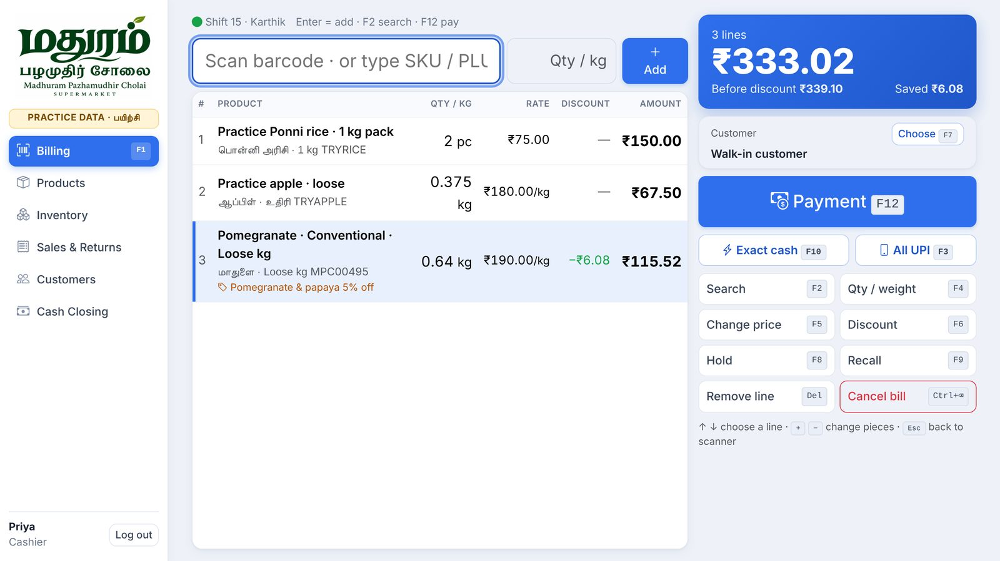

# Madhuram Pazhamudhir Cholai – Supermarket Management System

மதுரம் பழமுதிர் சோலை · Billing, stock, purchasing and daily accounts for a Tamil Nadu supermarket.

The system runs on the billing-counter PC and needs **no internet**. A small web server runs on that PC, and staff use it in a browser
window (Microsoft Edge in app mode). Barcode scanners in keyboard mode and Windows thermal printers work through the browser.
All data is in one SQLite database file on the PC. **Two automatic, checked backups**, one on the PC and one in Google Drive
(free), protect it even if the PC is lost.

> **This version supports one billing counter.** See [Multiple counters](#multiple-counters) before adding a second till.



## What it does

| Area | Highlights |
|---|---|
| **Billing** | Scan → bill → payment → receipt in a few keystrokes. **Barcode won't scan? Tap the product** on the panel below the bill (search, category buttons, best sellers). Customer search by any part of the name or phone. Exact barcode match only; unknown codes are refused, the bill stays intact, and a manager can link the code. Loose produce by PLU with weight to 3 decimals. Configurable scale-label barcodes with check digit. Search by English or Tamil name, SKU, PLU or barcode. **F10 exact cash and F3 all-UPI one-key payment**, hold/recall, cancel with reason, manager-PIN price override and discount, split tender (cash + UPI + card + customer credit), change due. A retried or double-clicked payment can never create two bills. |
| **Receipts** | 80 mm and 58 mm thermal layouts, A4 invoice, reprint marked DUPLICATE, Tamil product names. |
| **Owner tools** | **Today's prices** (change all fruit/veg rates in one screen, print an A4 Tamil/English price board), **Buy list** (what to buy tomorrow from real sales, by supplier, send on WhatsApp), **Loss watch** (cancelled bills, removed items, price changes, discounts, refunds, cash shortages, unprinted bills per cashier, with flags), **day summary to the owner's WhatsApp**, **credit (udhaar) reminders**. |
| **WhatsApp bills** | Free: type the customer's mobile at payment and the bill opens in the shop's own WhatsApp (Desktop app or Web) ready to send. Resend any old bill. Masked number in the audit log. A paid automatic option is described in the Owner guide. |
| **Quick add** | Scan a new barcode at the counter → "Add as a new product" → name, MRP, price, GST, shelf count → it is on the bill. A separate Quick add screen enters products one after another with Enter only, and picks from the starter catalogue so nothing is duplicated. |
| **Products** | 20,000-SKU starter catalogue loaded as *inactive candidates* (no invented prices, barcodes or tax rates). Base product vs sellable SKU, brand, variant, pack, purchase/sale unit conversion, MRP/cost/price, HSN, GST treatment, preferred supplier, reorder level, shelf, batch/expiry tracking. CSV/Excel import with preview, duplicate and row-level checks, all-or-nothing apply and undo. Code 128 shelf/item labels. |
| **Purchasing** | Suppliers, multi-item purchase orders, partial deliveries, goods receipts against the supplier invoice (total matched), cartons → pieces, free and damaged quantities, batch, expiry and real unit cost per lot, duplicate-invoice block, supplier returns, payments and outstanding balance. |
| **Inventory** | Lot-based stock ledger (opening, purchase, sale, return, waste, damage, expiry, stocktake, quarantine moves). Earliest-expiry-first selling; expired lots blocked. Low / out / near-expiry / dead stock / wastage views. Stocktake with expected, counted, difference, reason and approver. |
| **Sales & returns** | Find bills by number, date or customer. Full or partial returns, including weighed quantities, at the price actually paid with tax and discount shares; never more than is left. Refund method and stock disposition (sellable / quarantine / waste). Loyalty points reversed. |
| **Customers & offers** | Optional customers (walk-in never needs a phone number), history, loyalty points, approved credit accounts with limits and collections. Date-limited %, ₹-off, quantity and combo offers with priority; the cashier and the receipt show which offer applied. |
| **Cash closing** | Shifts with opening float, cash in/out, bank deposits, cash left for the next shift, denomination count and variance. Only cash moves the drawer. UPI/card settlement reconciliation with fees and unmatched items. |
| **Reports** | 21 reports, each showing its date basis, with drill-down to bills, print, CSV and Excel. Owner dashboard. |
| **Control** | Owner, manager, cashier, purchaser and auditor roles; manager approval PIN; audit log of price changes, discounts, refunds, write-offs, reopened shifts and every sale. |
| **Data safety** | Transactions for every money/stock change, exact decimals, migrations. **Double backup**: on this PC (hourly when changed, at start-up, at shift close, nightly) and a SHA-256-verified copy in free Google Drive. Compressed, tiered retention within the free 15 GB, red alerts on the dashboard, restore check, separate practice database. |

## Start here

1. **Windows setup** – [docs/WINDOWS_SETUP.md](docs/WINDOWS_SETUP.md) (install Python, run `Setup_Windows.bat`).
2. **Practise** – `Try_Demo.bat` opens a separate practice database with sample products and two weeks of bills.
   Logins `owner`, `manager`, `cashier`, `purchaser`, `auditor` · password `practice123` · approval PIN `1234`.
   Print [docs/Practice_Barcodes.html](docs/Practice_Barcodes.html) at 100 % and scan.
3. **Go live** – `Create_Owner.bat`, then `Start_Store.bat`. If you used the earlier pilot counter, run `Import_Pilot_Data.bat` first.

| Guide | For |
|---|---|
| [Cashier SOP](docs/CASHIER_SOP.md) | Counter staff, with screenshots |
| [Owner guide](docs/OWNER_GUIDE.md) | Owner / manager: products, purchases, stock, closing, reports |
| [Backup & restore](docs/BACKUP_RESTORE.md) | Owner / whoever looks after the PC: the two backups (PC + Google Drive) |
| [Capacity test](docs/CAPACITY.md) | One busy year (146,000 bills) tested: speed, database and backup sizes, Drive space |
| [Online hosting on Hostinger VPS](docs/HOSTINGER_VPS.md) | Low-cost hosting (about ₹599/month) to use the system from anywhere; billing then needs the internet |
| [Hardware](docs/HARDWARE.md) | Scanner, weighing scale, thermal printer setup and what is still untested |
| [GST & invoices](docs/GST_AND_INVOICES.md) | Settings the store's accountant must confirm |
| [Module status](docs/MODULE_STATUS.md) | What was built, tested, and still needs store data, accountant approval or hardware |
| [Acceptance results](docs/ACCEPTANCE_RESULTS.md) | The specification's 11 acceptance tests, actual results |
| [Database schema](docs/SCHEMA.md) | Tables and columns |
| [Changing the software](docs/CHANGING_THE_SOFTWARE.md) | How to add features later and install updates safely |

## Files

```
Setup_Windows.bat  Start_Store.bat  Try_Demo.bat  Create_Owner.bat
Install_Madhuram.bat  Setup_Backups.bat  Backup_Now.bat  Restore_Backup.bat  Import_Pilot_Data.bat     Windows launchers
data/Madhuram_20000_SKUs.csv     starter catalogue (20,000 candidate SKUs)
data/import_template.xlsx|csv    product import template
docs/                            guides, screenshots, results, schema
legacy_pilot/                    the earlier Tk pilot, kept for reference and data import
cholai/ core/ accounts/ catalog/ inventory/ purchasing/ customers/ sales/ expenses/ reports/   source code (Django)
templates/ static/               screens, styles, offline copies of Bootstrap and Chart.js
scripts/run_acceptance.py        end-to-end acceptance run; scripts/capture_screenshots.js re-takes doc screenshots
```

Data lives outside the program folder, in `%LOCALAPPDATA%\MadhuramPOS\store\` (live) and `…\demo\` (practice), each with its own
`backups\` folder. Updating the program never touches it.

## Development

```bash
pip install -r requirements.txt
MPC_MODE=demo python manage.py migrate && MPC_MODE=demo python manage.py seed_demo
MPC_MODE=demo python manage.py serve            # http://127.0.0.1:8765
MPC_MODE=test python manage.py test             # 50 automated tests
pip install requests && python scripts/run_acceptance.py   # real-process acceptance run → docs/ACCEPTANCE_RESULTS.md
```

## Multiple counters

This version is built and tested for **one counter**: one PC runs the server and the database, and bill numbers come from one
gap-free series per financial year. A second PC on the same shop network *can* open `http://<counter-PC>:8765/` if the server is
started with `--host 0.0.0.0`. Both tills would then share one stock count and one bill series without clashes, because every write
locks the database. But this is **not tested**, the cash-drawer shift is per counter name and is shared, and the second till stops
when the main PC or the network is down. Independent offline tills that sync later need a separate design: a per-counter bill
series and an outbox that sends sales when the link returns, with stock conflicts resolved centrally. That is future work.
