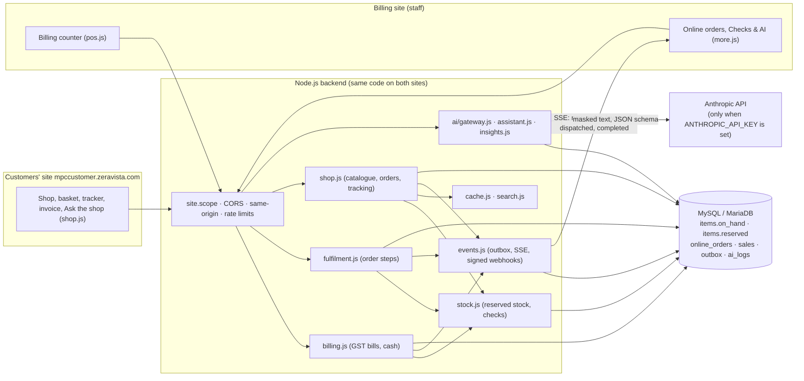
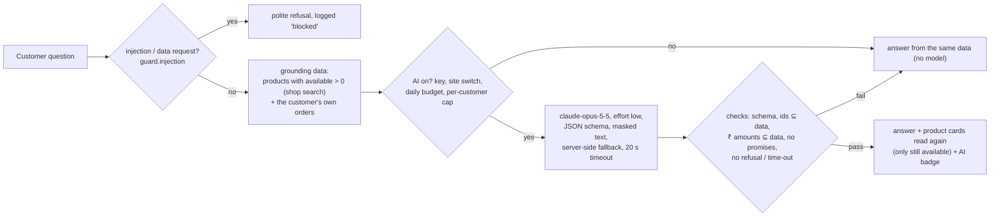

# Madhuram – billing site and customers' site on one backend

Two websites, one Node.js backend, one MySQL / MariaDB database:

| | Billing site (Domain A) | Customers' site (Domain B) |
|---|---|---|
| Address | your current address (e.g. `billing.your-shop.in`) | `mpccustomer.zeravista.com` |
| Users | owner, managers, cashiers | customers (mobile number + password) |
| Screens | `index.html` + `app.js`, `pos.js`, `more.js` | `shop.html` + `shop.js` |
| API | `/api/…` (staff) | `/api/shop/…` only |
| Login cookie | `mpc_sid` (staff session) | `mpc_cust` (customer session) |

Stack: Node.js 22, Express 4, mysql2, plain browser JavaScript (no build step), Hostinger Web Apps, optional Anthropic API
(`@anthropic-ai/sdk`, model `claude-opus-5-5`).

## 1. Architecture



Two ways to run it (same code):

* **Two copies** (recommended on Hostinger): the billing app with `SITE_ROLE=billing`, the customers' app with `SITE_ROLE=shop`, both
  with the same `DB_*` settings. The shop copy wakes the billing copy after each change with a signed call
  (`BILLING_URL`, `EVENTS_SECRET`); the billing copy also reads new events from the database every second, so nothing is lost if
  that call fails.
* **One copy answering both addresses**: `SHOP_HOST=mpccustomer.zeravista.com`, `BILLING_HOST=<billing address>`. Requests are routed by
  the `Host` header; any other address gets `421`.
* Without these settings the app works as before (staff at `/`, shop at `/shop/`).

## 2. Stock: physical, reserved, available

```
available = physical (items.on_hand) − reserved (items.reserved)
```

* **Physical** is what is in the shop, including bags packed for online orders that have not left yet.
* **Reserved** is held for open online orders (new, accepted, packing, ready, out).
* **Strict visibility:** every customer list, search, section count, suggestion, "buy again", product page, basket check and
  assistant answer filters `on_hand − reserved > 0` in SQL. A product at 0 disappears at once (the shop caches are keyed to a
  change counter that every committed transaction bumps, on either site).
* Counter billing is never blocked by stock (a product in the customer's hand is sold; stock floors at 0). If that leaves
  `reserved > on_hand`, the product is hidden online and shows on **Checks & AI** as "oversold".

### No overselling

Every transaction that changes `reserved` first locks the product rows with `SELECT … FOR UPDATE` **in ascending id order**
(`stock.lockItems`), checks `on_hand − reserved`, then updates. Two customers buying the last piece: the second transaction waits
for the first, then sees `available = 0` and gets `409 "…has just sold out"`. The global lock order is
`shift → order → bill → products → stock lots`, so transactions never wait in a circle; InnoDB deadlocks (if any) are retried by
`db.tx`.

`stock.reconcile()` (at start-up, and the **Correct held stock** button) recomputes what each product should have reserved from the
open orders and fixes any difference under the same row locks, with an audit line.

## 3. Order workflow and data flow

```mermaid
sequenceDiagram
  participant C as Customer (shop site)
  participant API as Backend
  participant DB as Database
  participant S as Staff (billing site)
  C->>API: POST /api/shop/order
  API->>DB: BEGIN; SELECT items … FOR UPDATE (id order); check available
  API->>DB: INSERT order + lines; reserved += qty; INSERT outbox NEW_ONLINE_ORDER; COMMIT
  API-->>S: SSE event (chime, red count) – poll every 20 s as fallback
  S->>API: Accept, then "Bill & pack" at a counter (POST /api/checkout with order_id)
  API->>DB: GST invoice (sale, stock_pending=1), payment "cod" or UPI; reserved follows the bill; status packing
  S->>API: POST /orders/:id/dispatch (agent name, phone, tracking)
  API->>DB: status out, dispatched_at; outbox ORDER_DISPATCHED
  C->>API: GET /api/shop/track/:token (steps, agent, call button)
  S->>API: GET /orders/:id/complete (confirmation) → POST /orders/:id/complete
  API->>DB: stock out (first expiry first), reserved −= qty, COD cash into the counter's drawer (or UPI ref), status done
  C->>API: GET /api/shop/account/orders/:number/invoice (own completed orders only)
```

| Status | Meaning | Customer tracker step |
|---|---|---|
| `new` | placed, stock reserved | Order placed |
| `accepted` | staff saw it | Order placed |
| `packing` | GST invoice made at a counter, goods packed, still reserved | Billed & packed |
| `ready` (takeaway) | waiting at the counter | Ready for pickup |
| `out` (delivery) | with the delivery person (name, phone, tracking) | Delivery agent assigned |
| `done` | Process completed: stock out, reservation released, cash settled | Process completed |
| `cancelled` | before the invoice: reservation released; after: credit note (manager PIN), reservation released | – |

**Cash on delivery** (`cod` payment method, online orders only) adds no cash at billing time. At **Process completed** the amount goes
into `cash_moves` (kind `cod`) of the completing counter's open shift, so the cash closing expects it; or the UPI transaction number
is recorded (`settle_method`, `settle_ref`). **Cancel after the invoice** writes a full credit note (`sale_returns`, no restock
because nothing left the shelf), gives back cash / credit / points that were taken, and takes back loyalty points earned.
**Returns** of a completed order use the normal Returns screen; returns of a not-yet-completed online bill are refused.

## 4. Security

* **Site scoping** (`site.scope`): on the customers' site only `/api/shop/…`, the shop page and its files exist; the staff API,
  staff pages, `/internal/events` and the cron address return 404. On the billing site `/api/shop/…` returns 404 and `/shop/`
  redirects to the customers' site.
* **Separate audiences:** staff sessions (`sessions` table, cookie `mpc_sid`) are only read on the billing site; customer sessions
  (`customer_sessions`, cookie `mpc_cust`) only on the customers' site. Both are opaque random tokens (stored as SHA-256), HttpOnly,
  SameSite=Lax, Secure on https, with no `Domain` attribute, so a browser never sends one site's login to the other.
* **Customer data scoping:** every customer endpoint takes the customer id from the session, never from the request: addresses,
  orders, invoices (`WHERE number=? AND customer_id=?`), UPI payment numbers. A tracking link alone (sent on WhatsApp) shows progress,
  items and totals but not the name, address, payment details or invoice. Customer responses never contain costs, margins, supplier
  data or other customers' data.
* **CORS:** no other website may call the API from a browser: a foreign `Origin` gets no CORS headers, a preflight gets 403, and every
  change request must come from the site's own pages (`Origin`/`Referer` = this address). `CORS_ALLOW` can list extra origins.
* **Rate limits** per visitor address (token buckets): staff logins 10/min, customer account actions 20/min (plus 5 wrong passwords
  per account per 15 min), orders 10/min (plus 5 per hour per address in the database), assistant 10/min, customers' site 600/min,
  billing site 900/min. Answer: 429 with `Retry-After`.
* **Signed events:** `X-MPC-Signature: sha256=HMAC(EVENTS_SECRET, timestamp + "." + body)`, `X-MPC-Timestamp` within 5 minutes,
  compared in constant time. The wake-up call carries no data the billing site trusts: it only triggers a read of the database outbox.
* Headers: CSP (`script-src 'self'`), `X-Frame-Options: DENY`, `nosniff`, COOP/CORP same-origin, HSTS on https.

## 5. AI gateway (`src/ai/`)



* **Off by default:** nothing is sent anywhere unless `ANTHROPIC_API_KEY` is set on the server. Kill switches: hosting variables
  `AI_SHOP=off`, `AI_BILLING=off`, `AI_ALL=off` (immediate), and owner switches in Settings → AI helpers.
* **Masking before sending and logging:** phone numbers, e-mail, UPI IDs, card / Aadhaar / PAN-like numbers, OTP / PIN / UTR
  values, any long number.
* **The model never computes money or stock:** it only writes a short text and picks product ids / order numbers from the data it
  was given. Prices, GST, totals, stock and ledgers come from the database. Rupee amounts in its text must be ones from the data;
  otherwise the answer is replaced.
* **Never promises** discounts, refunds, coupons or price changes (checked on the output); those questions get a "talk to the
  shop" hand-off with call / WhatsApp buttons.
* **Budgets:** shop-wide daily token budget, questions per customer per day, `max_tokens` per answer, one retry, timeout.
* **Log:** `ai_logs` (masked question and answer, outcome ok / blocked / fallback / refused / error / off / limit, reason, tokens, time),
  shown on **Online orders → Checks & AI** with the stock checks and an optional AI summary for the owner.

## 6. Performance (6,000–20,000 products)

* `search.js`: in-memory word index of names (English and Tamil) and categories; prefix search with plural handling, then the database
  reads only the matching rows; falls back to "contains" search for unusual words. Rebuilt only when products change.
* `item_stats.sold_30d`: bills per product in the last 30 days, refreshed every 10 minutes (sorting "popular" without counting bills
  on every page).
* `cache.js`: product lists, categories, offers and section counts cached in memory, keyed by the database change counter
  (`sequences._changes`, bumped after every commit on either site) – a sale or stock change clears them at once; 2-minute expiry.

## 7. Folder structure (new parts marked ★)

```
cloud/
  server.js                 Express app, security headers, site scoping, background jobs (★ jobs per site)
  ARCHITECTURE.md           ★ this file
  src/
    site.js                 ★ which site a request is for, route scoping, CORS, same-origin, rate limits
    stock.js                ★ reserved stock: row locks, hold/release, reconcile, popular counts, anomalies
    fulfilment.js           ★ order steps: accept, ready, dispatch, Process completed, cancel + credit note, line changes
    events.js               ★ outbox, Server-Sent Events to staff screens, HMAC-signed webhooks
    cache.js · search.js    ★ shop caches with instant invalidation; word index
    invoice.js              ★ customer's GST invoice page
    ai/guard.js             ★ masking, injection patterns, promise check, schema check, amount check
    ai/gateway.js           ★ the only AI caller: switches, budget, timeout, structured output, log
    ai/assistant.js         ★ "Ask the shop" (grounded in available products and the customer's own orders)
    ai/insights.js          ★ Checks & AI for the owner, AI log
    shop.js                 catalogue (strict visibility), placing orders (locks + reservation), tracking, customer orders
    billing.js              checkout: GST bill, payments incl. cod, online order → invoice at packing
    returns.js, catalog.js, custauth.js, auth.js, db.js (★ change counter, new columns), schema.sql (★ outbox, item_stats, ai_logs)
    routes/api.js, routes/more.js   (★ order steps, events, checks, AI log, invoice, assistant)
  public/
    shop.html · shop.js · shop.css   customers' site (★ 4-step tracker, agent card, invoice, sold-out basket check, Ask the shop)
    index.html · app.js · pos.js · more.js · app.css   billing site (★ live order alerts, step buttons, dispatch,
                                                        Process completed confirmation, cancel with PIN, Checks & AI, COD at the till)
    print.js                ★ print button of the invoice page
  test/
    platform.test.js        ★ the edge cases below
```

## 8. Database changes

| Table | New columns / table | Purpose |
|---|---|---|
| `items` | `reserved DECIMAL(12,3)` | stock held for open online orders |
| `sales` | `stock_pending TINYINT` | an online order's invoice whose goods have not left the shop yet |
| `online_orders` | `packed_at, ready_at, dispatched_at, agent_name, agent_phone, tracking, completed_at, completed_by, settle_method, settle_ref, settle_shift_id, cancelled_at, void_return_id` | the order steps, delivery person, cash-on-delivery settlement, credit note |
| `outbox` ★ | `id, type, data, created_at, pushed, hooked, attempts, next_try` | events written in the same transaction as the change |
| `item_stats` ★ | `item_id, sold_30d, updated_at` | popular sorting |
| `ai_logs` ★ | `at, site, kind, customer_id, user_id, question, answer, outcome, reason, model, tokens_in, tokens_out, ms, ip` | AI audit trail (masked) |
| `cash_moves` | kind `cod` | cash on delivery handed in |
| `payments` | method `cod` | cash on delivery (online orders only) |

All added automatically at start (`db.migrate`), safe when two copies start together.

## 9. API (new and changed)

Billing site (staff login; permission in brackets):

| Method & path | What |
|---|---|
| `GET /api/orders?tab=open\|done\|cancelled\|all` (orders) | list, cash on delivery still out, customers' site address |
| `GET /api/events` (orders) | Server-Sent Events: `NEW_ONLINE_ORDER`, `ORDER_INVOICED`, `ORDER_DISPATCHED`, `ORDER_COMPLETED`, `ORDER_CANCELLED`, … |
| `POST /api/orders/:id/accept` · `/ready` (orders) | steps |
| `POST /api/orders/:id/bill` (bill) → `POST /api/checkout` with `order_id` | invoice at packing (`cod` or UPI) |
| `POST /api/orders/:id/dispatch` (orders) | `agent_name`, `agent_phone`, `tracking` |
| `GET /api/orders/:id/complete` · `POST …/complete` (orders) | confirmation summary · `counter`, `method` cash/upi, `ref` |
| `POST /api/orders/:id/cancel` (orders; refund approval after the invoice) | `note`, `approval`, `counter` |
| `POST /api/orders/:id/line` (orders) | less / not available before the invoice |
| `GET /api/checks` (orders), `POST /api/stock/reconcile` (products) | stock checks, correct held stock |
| `GET /api/ai/logs` (reports) | AI log and status |
| `POST /internal/events` | signed wake-up from the customers' site |

Customers' site:

| Method & path | What |
|---|---|
| `GET /api/shop/items` | available products only |
| `POST /api/shop/order` | locks, checks available, reserves (409 when sold out) |
| `GET /api/shop/track/:token` | steps, delivery person; full details only for the customer who ordered |
| `POST /api/shop/track/:token/payref` | own order only |
| `GET /api/shop/account/orders/:number/invoice` | own completed orders only |
| `POST /api/shop/assistant` | Ask the shop |

## 10. Edge cases – test checklist

All run against a real database: `npm test` (`test/platform.test.js`, `test/stage2.test.js`).

- [x] Two customers buy the last piece at the same moment → one order, one `409 sold out`; reserved = 1; the product disappears from
      list, search and lookups. Five customers, three pieces → exactly three orders.
- [x] Stock reaches zero at the counter → the product vanishes from list, search, section counts and suggestions at once (cache
      cleared by the sale); ordering it gives 409; stock in → visible again.
- [x] Cancel before the invoice → reserved released, product visible again; cancel twice refused.
- [x] Cancel after the invoice (cash on delivery) → needs manager approval (403 without), credit note with no restock, reserved
      released, physical stock unchanged.
- [x] Dispatch, then Process completed with cash → cash closing expects the amount, stock leaves, reserved released; cancel afterwards
      refused ("use Returns"); returns of a not-completed online bill refused.
- [x] Weighed item billed heavier → reservation follows the bill; `cod` refused for counter bills; UPI settlement recorded.
- [x] Held stock drift → shown on Checks, corrected by the owner (cashier refused); counter sale of reserved stock → "oversold" check.
- [x] Cross-domain: staff cookie on the customers' site → staff API 404; customer cookie on the billing site → customers' API 404 and no
      staff login; unknown address 421; `/shop/` on the billing site redirects; foreign Origin → 403, preflight 403, no CORS header.
- [x] Customer scoping: another customer cannot download an invoice (404) or set a UPI number (404); a tracking link alone hides name,
      address and payment.
- [x] Signed events: good signature accepted; changed body, old timestamp, missing signature refused; not available on the customers'
      site. Outbox event reaches an open billing screen over SSE.
- [x] Rate limit: the 11th login in a minute from one address → 429 with `Retry-After`.
- [x] Prompt injection ("ignore previous instructions…", asking for cost price / margins) → refused without calling the model.
- [x] Model output: unknown or out-of-stock product ids dropped; discount promise replaced with a hand-off; made-up price replaced;
      refusal and time-out fall back to the search answer; personal details masked before sending and in the log; kill switch stops
      calls; daily budget stops calls.

## 11. Operating notes

* **Products need stock to appear online.** With strict visibility, a product whose stock was never entered (0) is not shown. Enter
  stock through Purchases, Products → Stock in, or a stock count.
* **Cash on delivery out** and **orders waiting too long** are on Online orders → To do / Checks & AI.
* Events and logs are kept 30 days (outbox) and indefinitely (ai_logs, audit).
