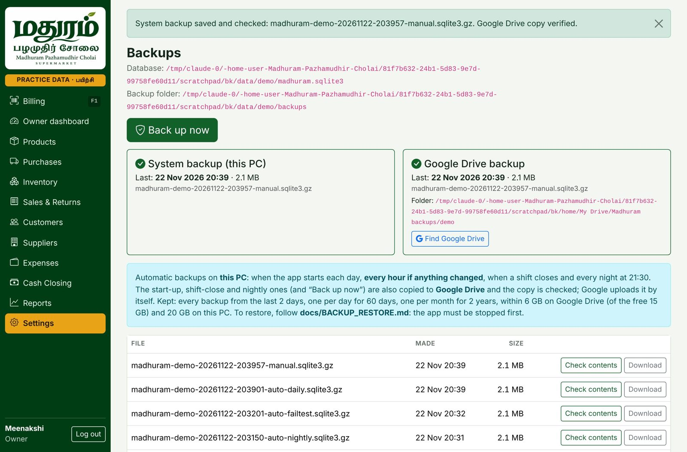

# Backup and restore

## Two backups, both automatic and both checked (free)

| | **1. System backup (this PC)** | **2. Google Drive backup** |
|---|---|---|
| Where | `%LOCALAPPDATA%\MadhuramPOS\store\backups\` | `My Drive\Madhuram backups\store\` in Google Drive (free 15 GB account) |
| When | Start-up (once a day), **every hour if anything changed**, every shift close, every night at 21:30, *Back up now* | Start-up, every shift close, every night at 21:30, *Back up now* |
| Protects against | Wrong actions, a damaged database | A stolen, burnt or failed PC |
| Kept | Every backup of the last 2 days, one a day for 60 days, one a month for 2 years, up to 20 GB | Same tiers, up to **6 GB** (leaves the rest of the free 15 GB for Gmail and Photos) |

How each backup is made:
1. A consistent snapshot of the whole database (products, stock lots, bills, payments, returns, shifts, purchases, customers,
   settings, audit log) with SQLite's online-backup method. **Billing continues normally**: in the one-year test, scans took
   20 ms during a backup, the same as without one.
2. `PRAGMA integrity_check` on the copy. A copy that fails is not kept.
3. gzip compression (`.sqlite3.gz`, about 4–5× smaller).
4. Copy to the Google Drive folder, then **both files are read back and compared (SHA-256)**. Google Drive for desktop then
   uploads it to the cloud by itself, also when the internet comes back after an outage.

Manual backups (*Back up now*, `Backup_Now.bat` checks) are never deleted automatically on this PC.

### One-time setup

`Install_Madhuram.bat` does this for you. To redo it, double-click **`Setup_Backups.bat`**:

1. If Google Drive for desktop is missing, it offers to install it (free, from Google). Sign in with **the shop's Google
   account** (not a staff member's personal one). A drive called *Google Drive (G:)* appears in File Explorer.
2. It finds `G:\My Drive` and saves it in Settings → Backups.
3. It creates the Windows scheduled task **Madhuram Nightly Backup** (21:30 every day; if the PC was off, it runs at the next
   switch-on).
4. It makes and checks the first double backup and shows both results.

### Is it working?

- **Settings → Backups** shows two cards. Both must be **green**. A card turns red if its last good backup is more than
  26 hours old or the last attempt failed, with the reason.
- The **Owner dashboard** shows a red bar as soon as either backup is not up to date.
- A failed Google Drive copy never stops billing or the PC backup; it is written to the audit log.
- Once a month, open <https://drive.google.com> on your phone → *Madhuram backups* and check that today's file is there.

### If Google Drive shows red

| Message | Fix |
|---|---|
| Google Drive folder not set | Install Google Drive for desktop, sign in, then Settings → Backups → **Find Google Drive** |
| Could not copy to Google Drive (G:\My Drive …) | Google Drive is not running or signed out: open it from the Start menu, then *Back up now* |
| Storage full in Google Drive | Free space in Drive (Gmail/Photos), or lower the budget: set the Windows environment variable `MPC_DRIVE_BUDGET_GB` (for example `4`) |



## Check a backup (restore test without touching the live data)

Settings → Backups → **Check contents** on any file. This opens the backup read-only, as a separate database, and shows the
integrity result, the last bill number and total, the stock on hand, and the last shift's float, expected and counted cash.
Compare these with the live screens. Do this once a month.

`Backup_Now.bat` makes a fresh double backup and shows the same check for it.

## Restore (recovery procedure)

Use this when the PC's database is damaged or a wrong action must be undone.

1. **Stop billing.** Close the `Start_Store.bat` window. Make sure no Madhuram window is still open.
2. Choose the backup: normally the newest file, or the one just before the problem. Check it first as above if the program
   still opens. If the PC itself is lost, take it from Google Drive (drive.google.com → *Madhuram backups* → Download).
   `.sqlite3.gz` files are restored directly; there is no need to unzip them.
3. Double-click **`Restore_Backup.bat`**, drag the backup file into the window, press Enter and type `YES`.
   - The backup is checked again.
   - The current database is **kept**, renamed `madhuram-before-restore-YYYYMMDD-HHMMSS.sqlite3`. Nothing is deleted.
   - The backup is copied into place.
4. Start `Start_Store.bat`. Check:
   - the **last bill number** in Sales & Returns;
   - stock of a few items you know (Products → item → stock lots);
   - **Cash Closing**: the last shift's figures.
5. Anything sold after the backup was taken is not in the restored data. Re-enter those bills from the paper receipts, or
   receive/adjust stock with a stocktake.

On a new PC: install as in [WINDOWS_SETUP.md](WINDOWS_SETUP.md), run `Setup_Windows.bat`, then restore as above. You do not
need to create the owner again, because the backup contains the staff logins.

Command-line equivalents (from the program folder, with `set MPC_MODE=store`):

```bat
.venv\Scripts\python.exe manage.py verify_backup "C:\path\to\backup.sqlite3.gz"
.venv\Scripts\python.exe manage.py restore_backup "C:\path\to\backup.sqlite3.gz"
```

## Tested

`scripts/run_acceptance.py` closes a shift, makes a backup through the web screen, restores it into a **separate** database
folder with `restore_backup`, and compares the last bill, every stock balance and the shift totals: they matched
([ACCEPTANCE_RESULTS.md](ACCEPTANCE_RESULTS.md), test 10). This has not yet been tried on the shop's Windows PC; do one restore
drill there before going live, once from a file downloaded from Google Drive.

Automated tests also cover: the compressed backup, the verified Drive copy, refusal of a cut-off (damaged) backup file, the
retention tiers over two years of backups, and the size budget.

## Practice data

The practice database (`…\MadhuramPOS\demo\`) is separate and has its own backups. Deleting the `demo` folder and running
`Try_Demo.bat` builds fresh practice data. The `seed_demo` command refuses to run against the store database.
