# Cashier SOP · காசாளர் வழிகாட்டி

Screenshots are from the practice database (`Try_Demo.bat`). Practise there first.

## Start of shift

1. Log in with **your own** user name. Every bill is recorded against the person logged in.
2. If the screen says **"No shift is open"**, go to **Cash Closing**. Count the float in the drawer, enter it, and press **Open shift**.
3. Press **F1** (or click **Billing**). The cursor is in the scan box.

## Billing

| Do this | How |
|---|---|
| Packed item | Scan the barcode. Scanning the same pack again adds one more. |
| Several of the same pack | Type the number in **Qty / kg** (F4), then scan. Or type `3*` and then scan. |
| Loose fruit or vegetables | Scan or type the **PLU** (e.g. `101`). The weight box opens: enter the scale reading in kg, e.g. `0.375`, and press Enter. Or type `0.375*101` and press Enter. |
| Scale-printed sticker | Scan it. Weight and item come from the label. If it is refused, type the PLU and weight by hand. |
| Item without a barcode | **F2** search: type the English or Tamil name, SKU or PLU, move with ↑ ↓, press Enter. |
| Change quantity | ↑ ↓ to choose the line, then `+` / `−` (pieces) or **F4** (any quantity or weight). |
| Remove a line | Choose it, press **Del**. |
| Customer for points or credit | **F7**. Walk-in customers need nothing. |

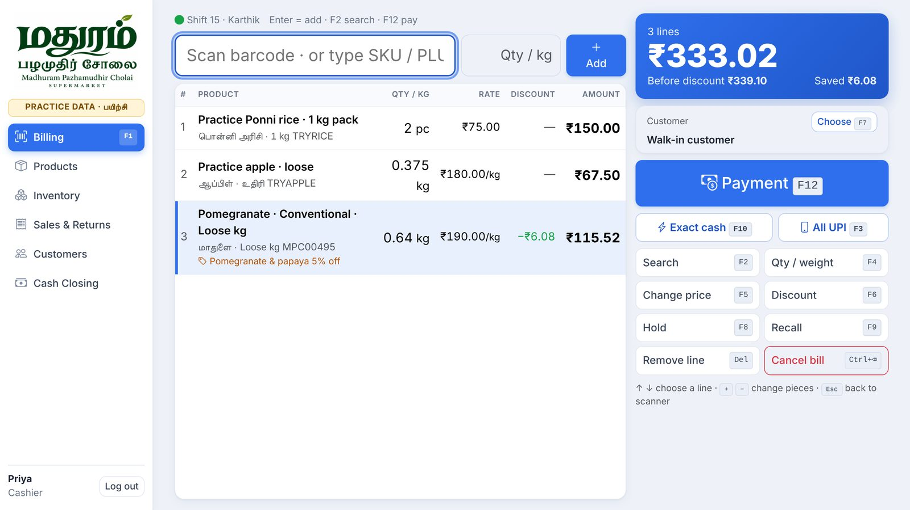

Each line shows the offer that applied (e.g. "Pomegranate & papaya 5% off"). The big total is what the customer pays.

### Barcode will not scan? Tap the product

Below the bill is the **product panel**: a search box, category buttons (★ Best sellers, ⚖ Loose (kg), Vegetables, Fruit, …)
and product tiles with price and stock. **Tap a tile to add it.** Loose items ask for the weight. Type in the search box to
find any product by English or Tamil name, PLU or code; **Enter** adds the first match. If the scanner fires while the
cursor is in the search box, the barcode is still added normally. **Delete** inside a box only clears the text, never a bill line.

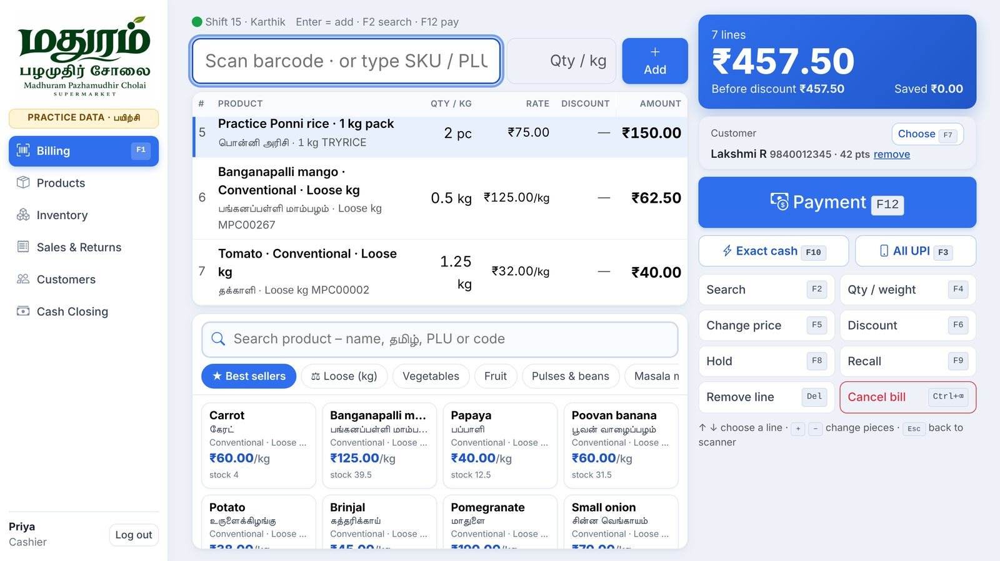

### Customer (F7)

**F7** opens the customer list straight away, most recent customers first. Type part of the **name** (any word, English or
Tamil) or part of the **phone number**; the matching customers appear in large rows with points and any amount owed.
**↑ ↓** and **Enter**, or tap. Nobody found? The name (or number) you typed is carried into **New customer** below – add the
phone and press Add. **Make it walk-in** removes a customer from the bill.

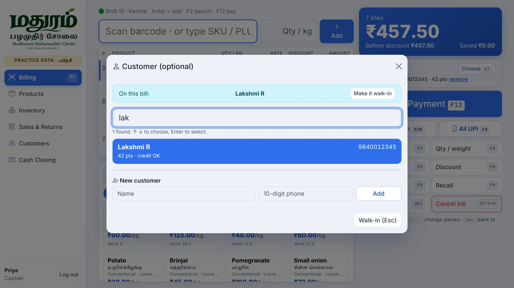

### New product scanned (barcode not in the system)

The screen says **"New barcode – not in the system yet"** and **nothing was added**; the bill is unchanged.
**Never sell the pack as a "similar" item.** Choose:

- **Enter – Add as a NEW product and bill it.** A short form opens with the barcode already filled in. Type the name as printed on the
  pack, choose the category, then **MRP**, **selling price** (leave it empty to use the MRP), **GST** and **how many are on the shelf
  now** (count them). Press **Enter** to go to the next box, and **Enter** on the last box to save. The product is created and goes on
  the bill at once. While you type the name, matching items from the 20,000-item starter list appear; pick one with ↓ and Enter so
  that no duplicate is made.
- **L – It is a product we already sell.** Find it and link this barcode (for example a new pack design of the same item).

A cashier needs a **manager's user name and PIN** in the same form. The price can never be above MRP. If the name is already on sale,
the system asks you to link the barcode instead. Everything is recorded in the audit log.

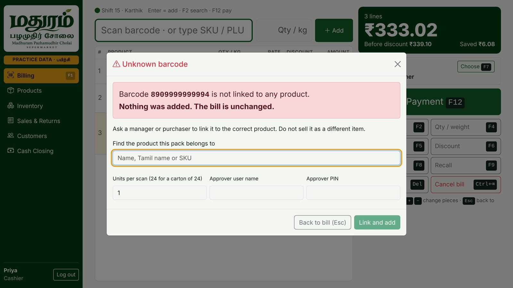
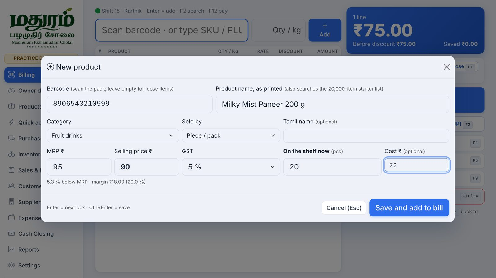
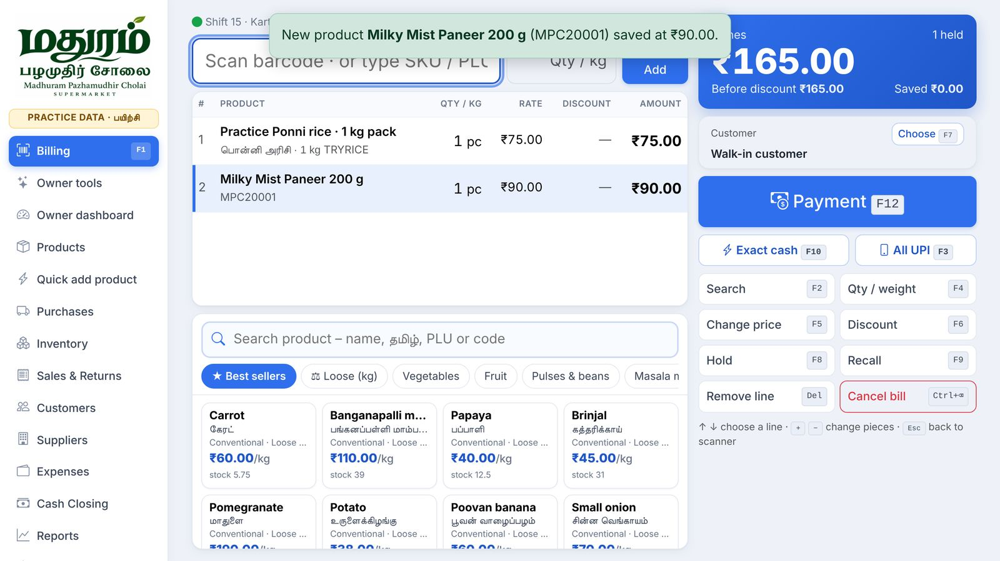

### Not enough stock / expired

If the system says only N are in stock, or that a lot is past expiry, do not sell it. Tell the manager. Expired stock is blocked
on purpose.

### Price change or discount

**F5** changes the price and **F6** gives a discount on the chosen line. Both need a reason. If your role cannot do it, a manager
types their user name and PIN. Both are recorded. The price can never be above MRP.

## Payment

**Fastest:** **F10** = paid in exact cash, the bill is saved at once. **F3** = all UPI (check the phone, then Enter).

1. Press **F12**. (Pressing **Enter** with all boxes empty means exact cash.)
2. Cash: type the cash received, or use the **Exact / ₹100 / ₹200 / ₹500 / ₹2000** buttons. The change is shown in green; if money
   is still due it says **Still to pay** in red.
3. UPI or card: **check the phone or card machine shows *successful*** before you complete. Type the amount (or press
   **All UPI** / **All card**) and the reference if you have it.
4. Split payment: fill more than one box, e.g. ₹100 UPI + cash for the rest.
5. Press **Enter** (Complete sale). The receipt prints and the screen is ready for the next customer.

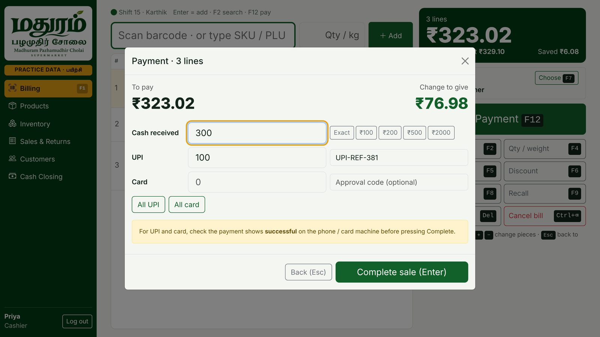

### Paper bill: every customer, every time

The paper bill prints by itself as soon as the sale is saved. **Always hand it to the customer**, even if they also get it on
WhatsApp. If it did not print (paper out, printer off), fix the printer and press **Reprint** under "Last bill". At closing,
Cash Closing lists any bill that was never printed.

### WhatsApp bill (optional, extra)

Only if the customer asks. If the customer wants the bill on WhatsApp, type their **10-digit mobile number** in **WhatsApp bill to** on the payment screen (a
saved customer's number is filled in already), then complete the sale as usual. WhatsApp opens with the bill written out and the
number filled in: **check it and press Send** in WhatsApp. To send the last bill afterwards, press the green **WhatsApp** button under
"Last bill". Any older bill: **Sales & Returns → open the bill → Send this bill on WhatsApp**.

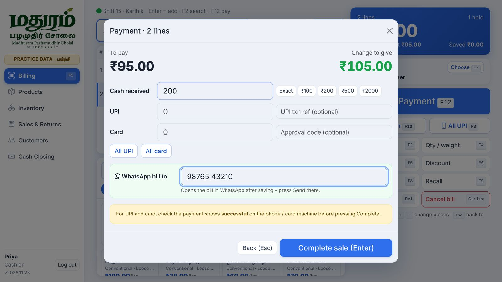

**Pressed Complete twice, or the network blinked?** The same bill can never be saved twice. Press Complete again if unsure.

### Receipt did not print

The bill is already saved. Use **Reprint** in the "Last bill" box, or find the bill in **Sales & Returns → Reprint**. Reprints are
marked **DUPLICATE** and do not change sales or stock.

| 80 mm | 58 mm |
|---|---|
|  | 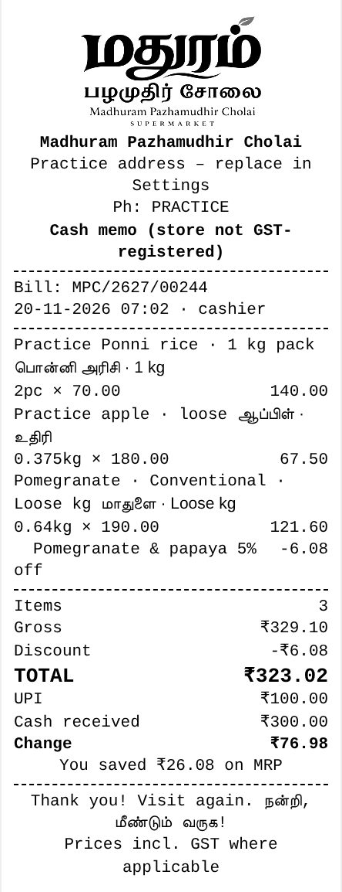 |

## Hold, recall, cancel

- **F8 Hold**: the customer went to fetch something. Give the bill a label. Serve the next customer.
- **F9 Recall**: bring the held bill back. Finish or hold the current bill first.
- **Cancel bill** (Ctrl+Backspace): needs a reason, which is recorded.

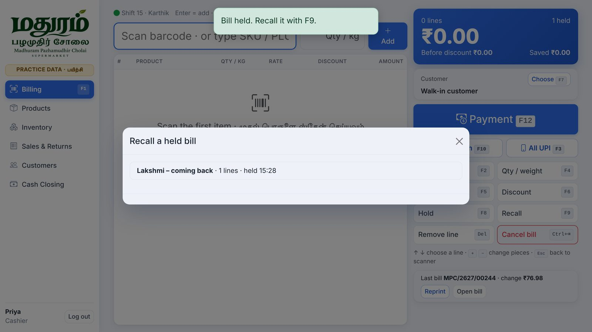

## Returns (manager or with a manager's PIN)

1. **Sales & Returns** → find the bill by bill number, customer or date → open it.
2. Type the quantity to return on each item (weights to 3 decimals). Choose where it goes: back to the shelf, quarantine (check
   first) or waste.
3. Choose the refund method, type the reason, and save. The system refunds what the customer **actually paid** for those units,
   after offers and discounts, and never more than is left on the bill.

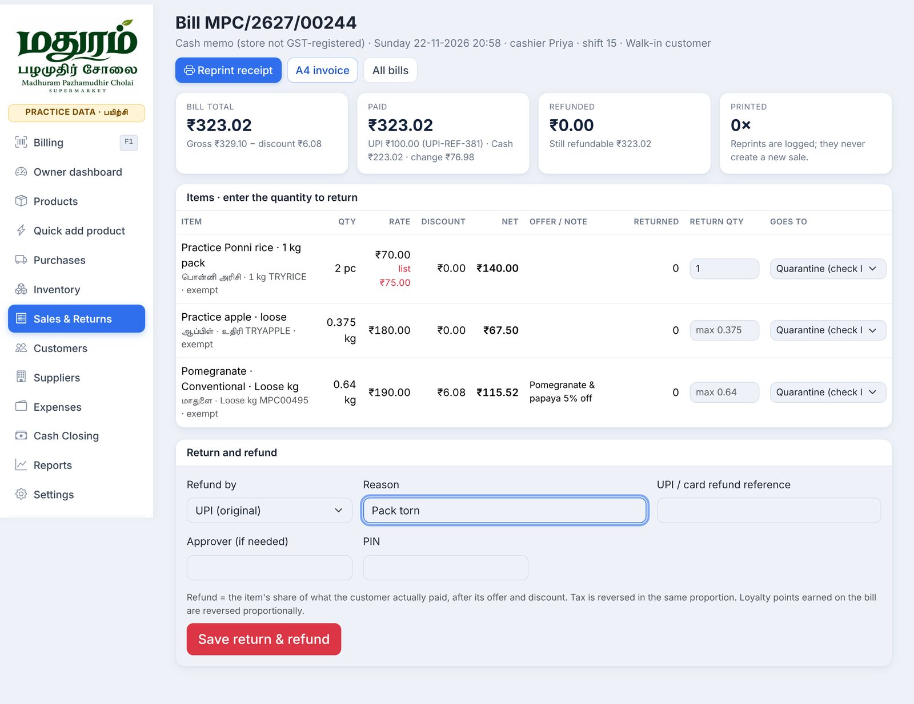
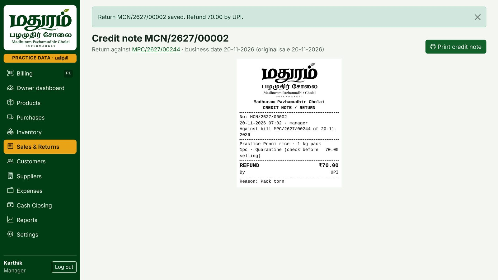

## End of shift

1. **Cash Closing**. If cash goes to the bank, record **Removed for bank deposit** with the slip number first.
2. Count the drawer note by note; the total fills itself. Enter how much you leave as float for tomorrow.
3. **Close shift**. The difference is shown and recorded. A backup is made automatically.

Expected cash = opening float + cash sales + other cash received − cash refunds − cash expenses − cash removed.
UPI, card and credit never change the drawer.

## Keys

| Key | Action | Key | Action |
|---|---|---|---|
| F1 | Billing / scan box | F7 | Customer |
| F2 | Search | F8 | Hold |
| F4 | Quantity / weight | F9 | Recall |
| F5 | Change price | F12 | Payment |
| F10 | Exact cash – complete at once | F3 | All UPI |
| F6 | Discount | Del | Remove line |
| ↑ ↓ | Choose line | + − | One more / less |
| Esc | Close dialog, back to scanner | Ctrl+Backspace | Cancel bill |
