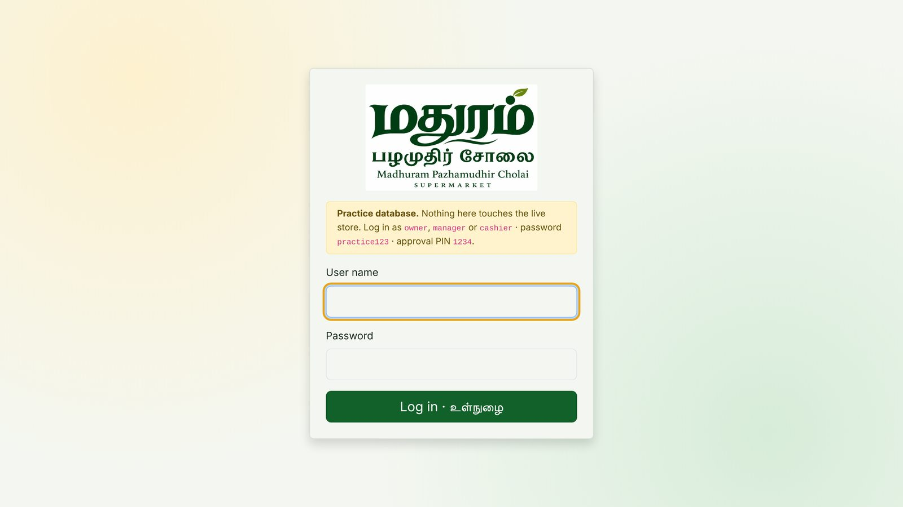
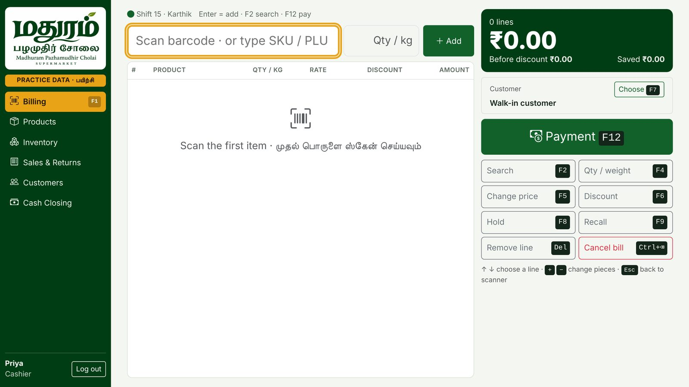
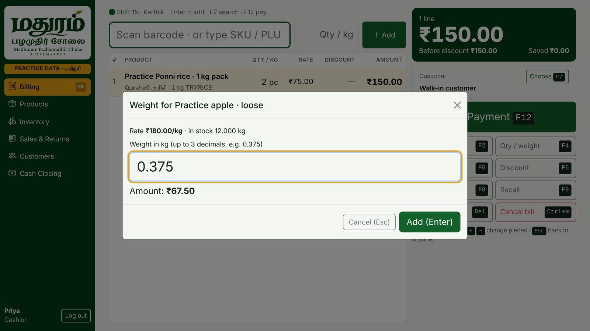
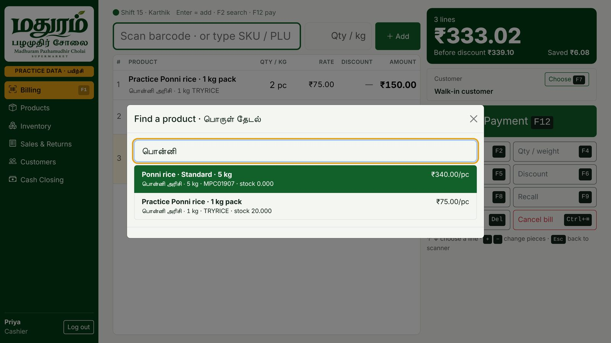
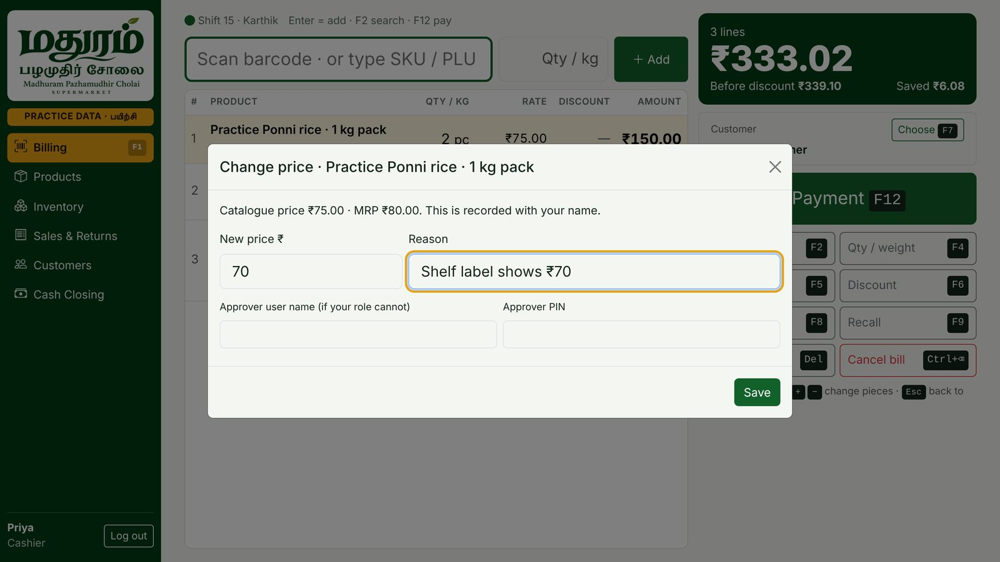
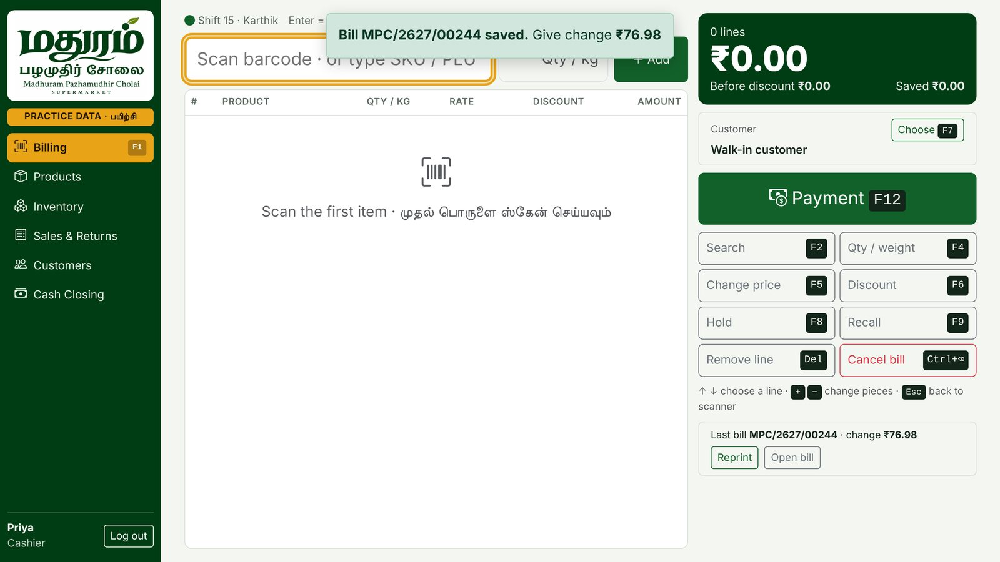
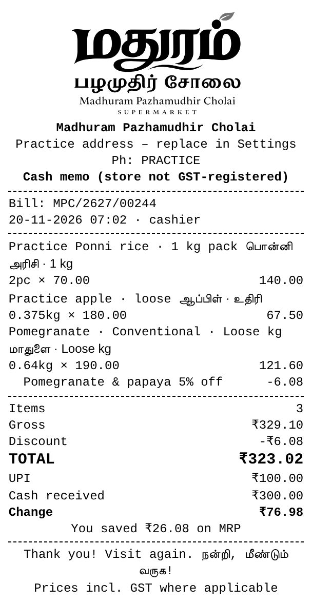
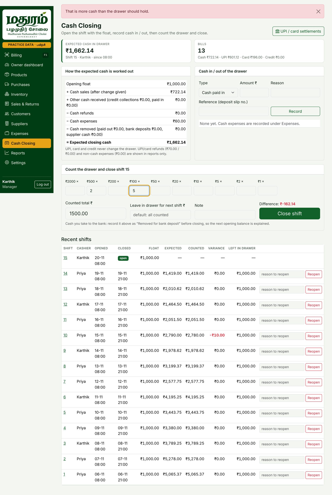

# Cashier SOP · காசாளர் வழிகாட்டி

Screenshots are from the practice database (`Try_Demo.bat`). Practise there first.

## Start of shift

1. Log in with **your own** user name. Every bill is recorded against the person logged in.
2. If the screen says **"No shift is open"**, go to **Cash Closing**. Count the float in the drawer, enter it, and press **Open shift**.
3. Press **F1** (or click **Billing**). The cursor is in the scan box.

## Billing

| Do this | How |
|---|---|
| Packed item | Scan the barcode. Scanning the same pack again adds one more. |
| Several of the same pack | Type the number in **Qty / kg** (F4), then scan. Or type `3*` and then scan. |
| Loose fruit or vegetables | Scan or type the **PLU** (e.g. `101`). The weight box opens: enter the scale reading in kg, e.g. `0.375`, and press Enter. Or type `0.375*101` and press Enter. |
| Scale-printed sticker | Scan it. Weight and item come from the label. If it is refused, type the PLU and weight by hand. |
| Item without a barcode | **F2** search: type the English or Tamil name, SKU or PLU, move with ↑ ↓, press Enter. |
| Change quantity | ↑ ↓ to choose the line, then `+` / `−` (pieces) or **F4** (any quantity or weight). |
| Remove a line | Choose it, press **Del**. |
| Customer for points or credit | **F7**. Walk-in customers need nothing. |

Each line shows the offer that applied (e.g. "Pomegranate & papaya 5% off"). The big total is what the customer pays.

### Unknown barcode

The screen turns red and says **nothing was added**. The bill is unchanged. **Never sell the pack as a "similar" item.**
Put the pack aside and call a manager. They can find the right product and link the barcode with their PIN, and it is then added.

### Not enough stock / expired

If the system says only N are in stock, or that a lot is past expiry, do not sell it. Tell the manager. Expired stock is blocked
on purpose.

### Price change or discount

**F5** changes the price and **F6** gives a discount on the chosen line. Both need a reason. If your role cannot do it, a manager
types their user name and PIN. Both are recorded. The price can never be above MRP.

## Payment

1. Press **F12**.
2. Cash: type the cash received, or use the **Exact / ₹100 / ₹200 / ₹500 / ₹2000** buttons. The change is shown in green; if money
   is still due it says **Still to pay** in red.
3. UPI or card: **check the phone or card machine shows *successful*** before you complete. Type the amount (or press
   **All UPI** / **All card**) and the reference if you have it.
4. Split payment: fill more than one box, e.g. ₹100 UPI + cash for the rest.
5. Press **Enter** (Complete sale). The receipt prints and the screen is ready for the next customer.

**Pressed Complete twice, or the network blinked?** The same bill can never be saved twice. Press Complete again if unsure.

### Receipt did not print

The bill is already saved. Use **Reprint** in the "Last bill" box, or find the bill in **Sales & Returns → Reprint**. Reprints are
marked **DUPLICATE** and do not change sales or stock.

| 80 mm | 58 mm |
|---|---|
|  |  |

## Hold, recall, cancel

- **F8 Hold**: the customer went to fetch something. Give the bill a label. Serve the next customer.
- **F9 Recall**: bring the held bill back. Finish or hold the current bill first.
- **Cancel bill** (Ctrl+Backspace): needs a reason, which is recorded.

## Returns (manager or with a manager's PIN)

1. **Sales & Returns** → find the bill by bill number, customer or date → open it.
2. Type the quantity to return on each item (weights to 3 decimals). Choose where it goes: back to the shelf, quarantine (check
   first) or waste.
3. Choose the refund method, type the reason, and save. The system refunds what the customer **actually paid** for those units,
   after offers and discounts, and never more than is left on the bill.

## End of shift

1. **Cash Closing**. If cash goes to the bank, record **Removed for bank deposit** with the slip number first.
2. Count the drawer note by note; the total fills itself. Enter how much you leave as float for tomorrow.
3. **Close shift**. The difference is shown and recorded. A backup is made automatically.

Expected cash = opening float + cash sales + other cash received − cash refunds − cash expenses − cash removed.
UPI, card and credit never change the drawer.

## Keys

| Key | Action | Key | Action |
|---|---|---|---|
| F1 | Billing / scan box | F7 | Customer |
| F2 | Search | F8 | Hold |
| F4 | Quantity / weight | F9 | Recall |
| F5 | Change price | F12 | Payment |
| F6 | Discount | Del | Remove line |
| ↑ ↓ | Choose line | + − | One more / less |
| Esc | Close dialog, back to scanner | Ctrl+Backspace | Cancel bill |
