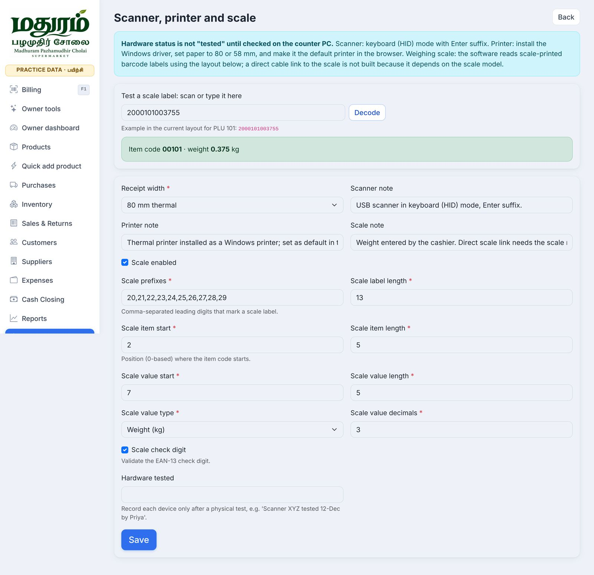

# Counter hardware

**None of the devices below has been tested on a physical unit yet.** Record each test under Settings → Scanner, printer and
scale → *Hardware tested* (e.g. "Scanner XYZ-100 tested 12-12-2026 by Priya") only after it works on the counter PC.

## USB barcode scanner – supported by design, untested

- Set the scanner to **USB keyboard (HID) mode** with **Enter (CR) suffix**. Most scanners do this from a setup barcode in their
  manual.
- Disable any prefix and "caps lock" options. Enable EAN-13, EAN-8, UPC-A and Code 128.
- The billing screen keeps the cursor in the scan box (F1 or Esc brings it back). Each scan is looked up by exact match on barcode,
  then SKU, then PLU, then scale label. Leading zeros are kept exactly as scanned.
- **UPC-A vs EAN-13**: some scanners send a 12-digit UPC-A as 13 digits with a leading 0. The system never guesses; if a pack is
  refused, link the code exactly as your scanner sends it.
- Test: print [Practice_Barcodes.html](Practice_Barcodes.html) at 100 % and scan each code in the practice database. Then test a
  real pack, a creased/damaged barcode and a store label.

## Thermal receipt printer (58 mm / 80 mm) – supported through Windows printing, untested

- Install the printer's **Windows driver**. Set the paper width (80 mm or 58 mm) in the driver and in Settings → Receipt width.
- The receipt page sets its own paper width and zero margins, so no page headers or footers are printed.
- **A paper bill prints for every sale; this cannot be switched off.** `Start_Store.bat` opens the billing window with
  `--kiosk-printing`, so each bill goes **straight to the Windows default printer with no print dialog**. Therefore:
  **Windows Settings → Bluetooth & devices → Printers → the thermal printer → Set as default** (and turn off
  "Let Windows manage my default printer"). The billing window uses its own Edge profile, so this works even if Edge is open for
  other things.
- Cash Closing shows a red warning listing any bill in the shift that was never printed, with a Reprint button for each.
- If printing fails, the bill is already saved. Reprint it from the "Last bill" box or Sales & Returns; it is marked DUPLICATE.
- **Not built**: opening the cash drawer through the printer (ESC/POS drawer kick). Most drawers connected to the printer can be
  set in the printer driver to open on every print; check the driver's "cash drawer" option.
- The A4 invoice prints on any office printer.

## Weighing scale

Two ways work today:

1. **Manual weight (always available)**: the cashier reads the scale and types the kg to 3 decimals (`0.375`), or `0.375*101`.
2. **Scale-printed barcode labels**: for a label-printing scale. Settings → Scanner, printer and scale:
   - Enable *scale labels*. Set the leading digits that mark a scale label (default 20–29), the position and length of the item
     code (matched to the item's PLU) and of the value, whether the value is **weight** (kg) or **price** (₹), the decimal places,
     and whether to check the EAN-13 check digit.
   - **Get a real sample label printed by your scale**, scan it into the *Test a scale label* box and confirm the item code and
     weight are decoded correctly *before* enabling this at the counter. The default layout `2 0 IIIII VVVVV C` (5-digit PLU,
     weight in grams) is common but not universal.
   - A wrong check digit is refused ("rescan or enter the weight by hand").

**Not built: a direct cable (RS-232/USB) link that reads the live weight from the scale.** The protocol differs between scale
models (Essae, Avery, CAS, etc.). It needs the make and model, and the scale on hand to test with.

## Payment devices

UPI QR and card machines are not connected to the software. The cashier confirms "payment successful" on the device and types
the amount, plus the reference number if wanted. The settlement screen matches the bank credits later.
