# Owner guide

For the owner and managers. Screenshots are from the practice database.

## Dashboard

**Owner dashboard** shows today and this month: net sales, returns, gross margin, expenses, tenders and the expected cash in the
drawer. The "Needs attention" list covers low stock, near expiry, expired lots and unsettled UPI/card money. The definitions are
at the bottom of the page and in every report.

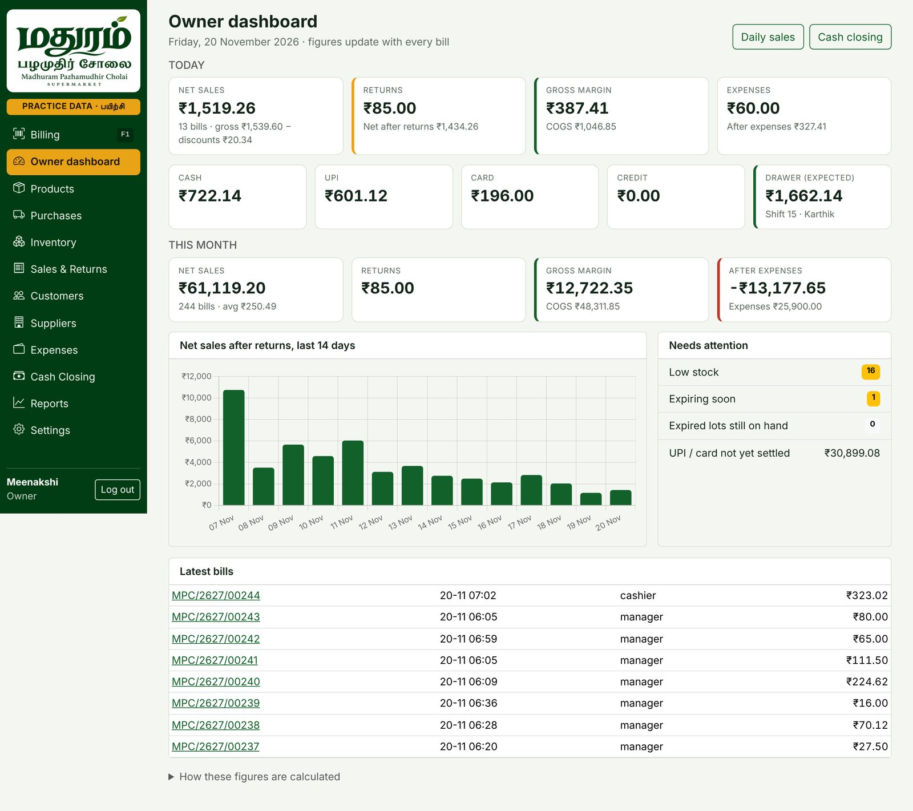

| Figure | Means |
|---|---|
| Gross sales | quantity × price charged, before offers and discounts |
| Discounts | offer and manual discounts on the bills |
| Net sales | gross − discounts = total of the bills |
| Returns | refunds given in the period (by refund date), at the price actually paid |
| Cost of goods sold | actual cost of the stock lots that were sold, minus the cost of items returned |
| Gross margin | net sales − returns − cost of goods sold |

## Products

The 20,000-SKU starter catalogue is loaded as **unverified candidates**, which are inactive and cannot be billed. It has no prices,
barcodes, brands, HSN codes, GST rates or suppliers, because those must come from the actual packs and supplier invoices. 207 of
the 376 base products have a Tamil name; the rest show "Tamil name needed". **Products → Show: Missing Tamil name** lists them.

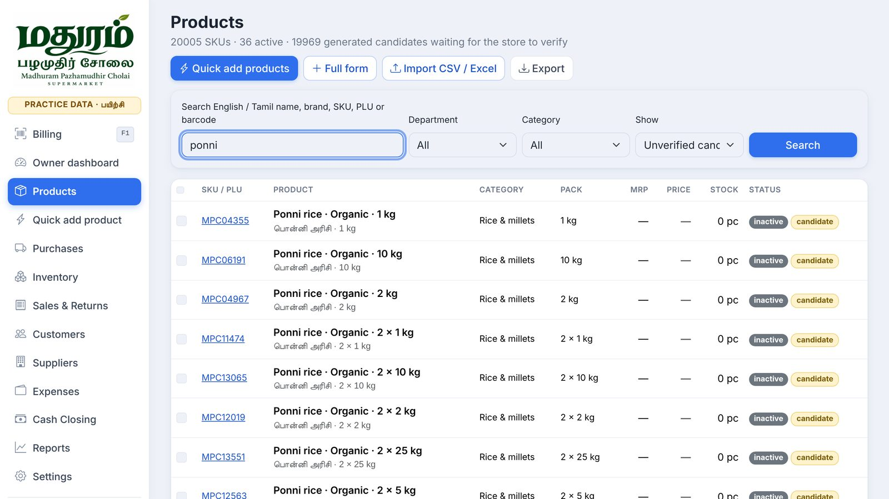

### Quick add: the fastest way to put products on sale

**Quick add product** (left menu) is one short form, made for entering a shelf of products in a row:

1. **Scan** the pack's barcode (leave it empty for loose items) and press **Enter**.
2. Type the **name** as printed. Matching items from the 20,000-item starter list appear; choose one with ↓ and **Enter** to activate
   it (its category, unit and Tamil name are filled in, and no duplicate is made). Otherwise keep typing for a new product.
3. **Category**, **Sold by** (piece or kg), **MRP**, **Selling price** (empty = MRP), **GST**, **Opening stock** and **Cost** (optional).
   The margin and the % below MRP are shown as you type.
4. **Enter** on the last box saves. The form clears and keeps the category, unit and GST for the next product.

It refuses a price above MRP, a barcode that already belongs to another product, and a name that is already on sale. Each product
appears under **Added now**, with a link to print its shelf label. The same form opens at the billing counter when a new barcode is
scanned (see the Cashier SOP). For hundreds of products at once, use the Excel import below.

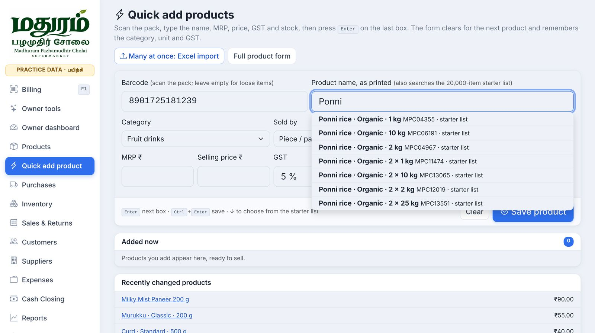

To start selling an item with every detail (the full form):

1. Find the candidate (or **New product** for another brand or size). Check the brand, pack size and MRP on the physical pack.
2. **Edit**: set brand, name, MRP, selling price and cost; the GST treatment and HSN once the accountant confirms them; purchase unit
   and conversion (e.g. 1 carton = 24 bottles); reorder level and shelf. Tick batch/expiry tracking for dated goods.
3. Scan the pack barcode under **Barcodes**. A *different pack size needs its own SKU*. "Units per scan" is only for an outer
   carton of the same pack.
4. **Verify & activate**. Every price change is recorded with your name.

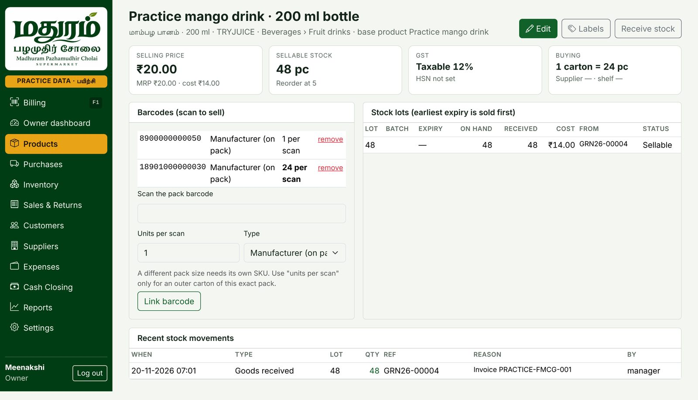

**Loose produce** uses the "Loose kg" SKUs, priced per kg, with a short **PLU** (e.g. 101) for the counter and the scale. A prepacked
500 g tray is a separate SKU sold by the piece.

### Bulk changes: CSV / Excel import

**Products → Import** → download the Excel template → fill only the columns you are changing (blank keeps the current value) →
upload. The preview lists every row with an error (duplicates in the file, a barcode already used by another SKU, a price above
MRP, a barcode saved as a number, missing fields). **If any row has an error, nothing is imported.** After applying, **Undo**
restores the previous values. In Excel, format SKU, Barcode, PLU and HSN as **Text** before typing so leading zeros stay.

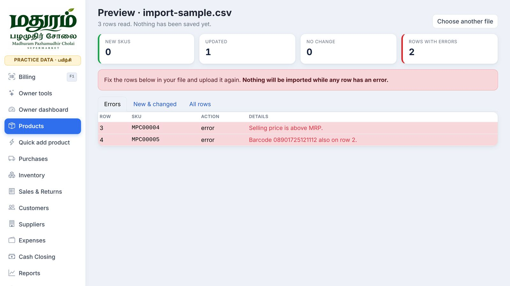

**Labels**: tick products in the list → *Print labels* (50 × 30 mm, Code 128 with price and Tamil name).

## Purchases

1. **Purchases → Purchase order**: supplier, items (scan or type SKU), quantity in purchase units (cartons, bags) and agreed cost.
2. When the delivery comes: open the order → **Receive delivery**, or **Receive goods (no PO)**. Enter the supplier invoice number,
   date and **invoice total**, then for each item the billed, free and damaged quantities, the cost per purchase unit, batch and
   expiry.
   - Stock is added in sale units: 2 cartons × 24 = 48 bottles.
   - Free goods lower the real cost per unit; damaged units are written off immediately.
   - The invoice total is compared with the lines; any difference is flagged.
   - The same supplier invoice cannot be entered twice.
3. Part deliveries leave the order "Partly received". **Close short** when the rest will not come.

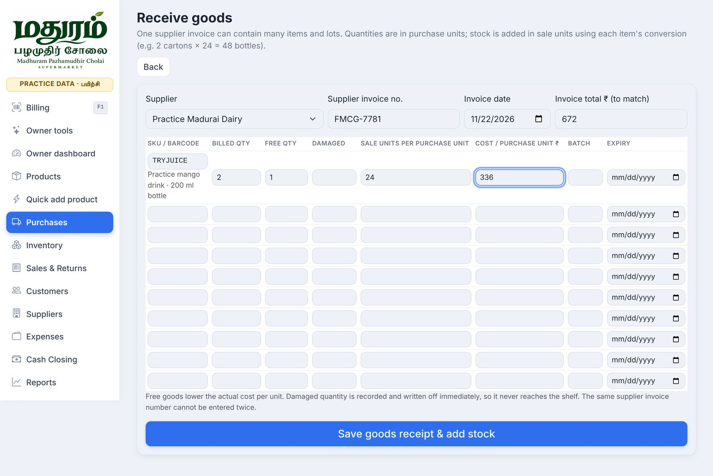
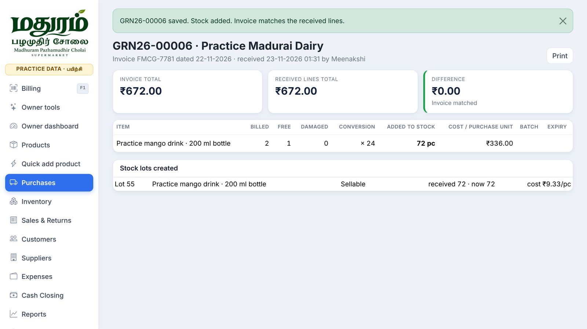

**Return to supplier** takes stock out of the chosen lots and reduces what you owe. **Suppliers** show each supplier's statement
and outstanding balance, where you record payments. A cash payment comes out of the drawer.

## Inventory

- **Low stock / Out of stock / Near expiry / Expired / Dead stock / Quarantine / Wastage** views.
- Each delivery is a **lot** with its own batch, expiry and cost. Sales take the earliest expiry first. Expired lots cannot be sold:
  write them off as *Expired*.
- **Adjust / write off** a lot: wastage, damage, expiry, or move to quarantine. A reason is required and your name is recorded.

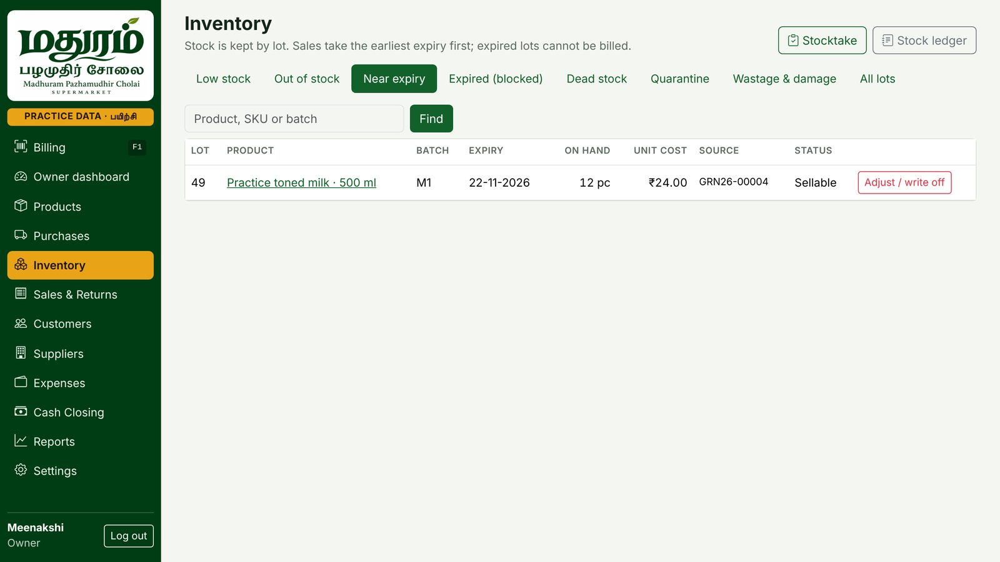

**Stocktake**: create a count sheet (one category or all), enter the counted quantities and a reason for each difference, then
**Approve & adjust**. Expected, counted, difference, reason and approver are kept.

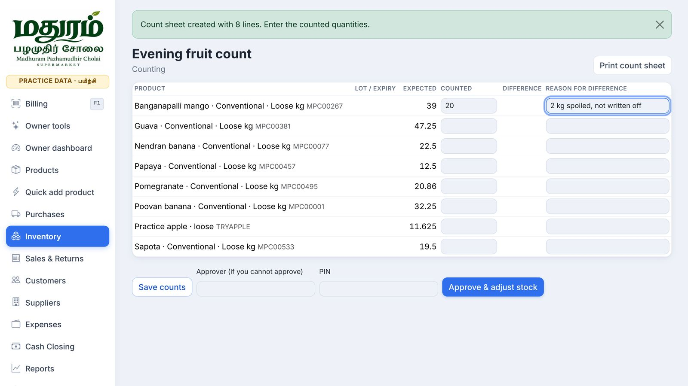

## Cash closing and bank

The cashier closes each shift (see the [Cashier SOP](CASHIER_SOP.md#end-of-shift)). Managers can **reopen** a closed shift with a
reason, which is logged. Cash taken to the bank is recorded as *Removed for bank deposit* with the slip number, so the next
opening float is explained.

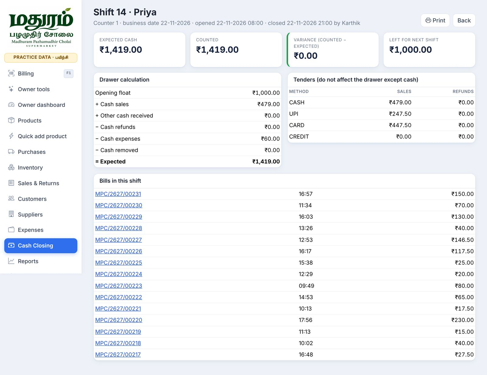

**UPI & card settlements** (Cash Closing → UPI / card settlements): when the bank credits the money, enter the amount credited and
the fees for the dates covered. The system matches all unsettled payments up to that date and shows any unexplained difference.
Payments older than 3 days that are still unmatched are flagged. Recording a payment at the counter is not the same as the bank
receiving it.

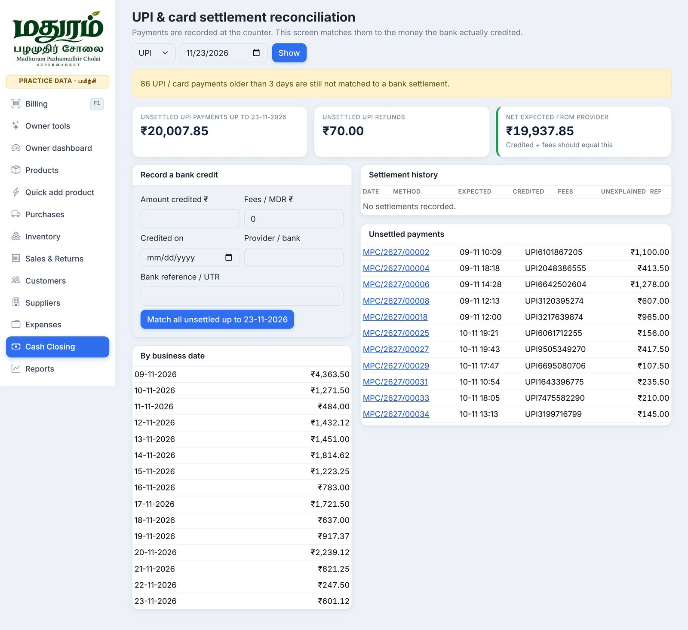

## Reports

**Reports** lists 21 reports: daily, item-wise, category-wise, hourly, cashier, payment methods, discounts, returns, margin, fast &
slow movers, purchase register, supplier outstanding, stock valuation, stock movements, expiry, wastage, customer credit, expense
register, tax summary, shift reconciliation and settlements.

Every report shows its **date basis**. Sales count on the bill date; **refunds count on the day they were given**, even for an older
bill. Click a category to see every bill line and return behind it; the lines add up to the category total. **CSV**, **Excel**
and **Print** are on every report.

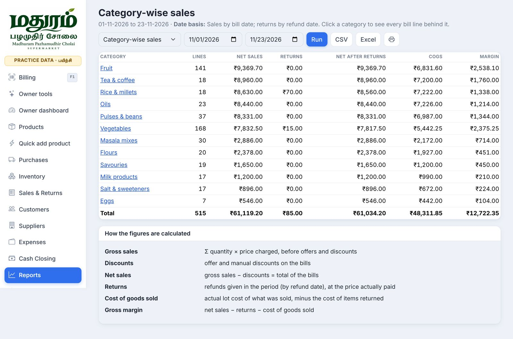
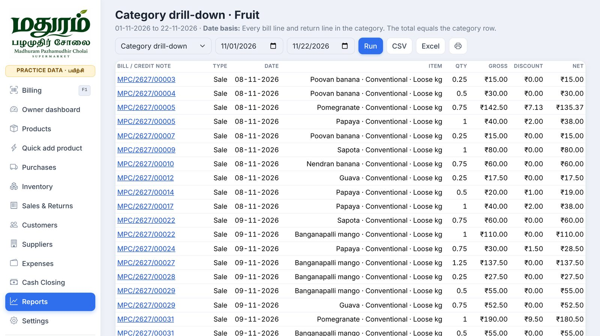
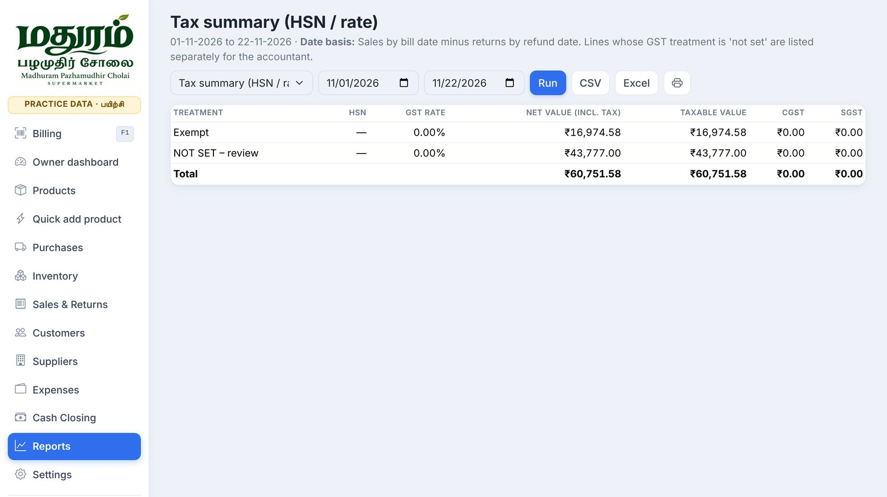

## Offers

**Settings → Offers**: % off, ₹ off per unit, quantity deals (buy 3 at ₹70 each) and combos (buy these together, ₹ off the set),
each with start and end dates and a **priority** (lower number is tried first; each line gets at most one offer). Returns refund
the discounted price, so offer effects are reversed automatically.

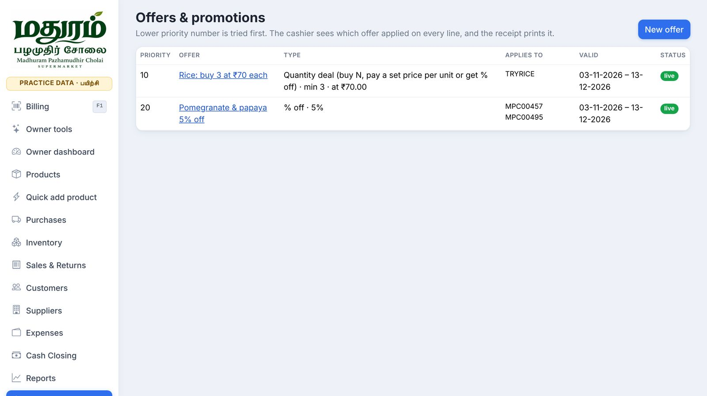

## WhatsApp bills

**Optional, and always in addition to the paper bill**, which prints for every sale and cannot be switched off.
**Free, built in.** At payment the cashier types the customer's mobile number; after the bill is saved, it opens in **the shop's own
WhatsApp** on the counter PC with the number and the full bill filled in, and the cashier presses **Send**. The message has the
shop name, bill number and date, every item with quantity × rate, discounts, the total, how it was paid and the change, "You saved ₹…
on MRP", GST included, loyalty points and your thank-you line.

One-time setup on the counter PC:
1. Install **WhatsApp** for Windows from the Microsoft Store (free) and link it to the shop's WhatsApp Business number
   (WhatsApp Business app on the shop phone → Linked devices). The phone stays with the shop; the PC sends from its number.
2. **Settings → WhatsApp bills**: keep *Open bills in* = **WhatsApp Desktop app**. If you prefer the browser, choose
   **WhatsApp Web** and log in at web.whatsapp.com once.
3. The first time, Edge asks "Open WhatsApp?". Tick **Always allow** and press Open.

Good to know:
- Costs nothing: no API, no monthly fee. It needs the internet only to send; billing itself stays offline. If the internet is down,
  WhatsApp sends the message when it comes back.
- Only the masked number (e.g. +91 98xxxxxx10) is written to the audit log. The number is not stored unless the customer has a profile.
- Send bills only to customers who ask for them. Do not use the shop's number for bulk offers; WhatsApp can block numbers reported as spam.
- The message is a copy of the bill. The printed receipt / A4 invoice stays the tax document.

### Later: fully automatic WhatsApp (paid)

If you want bills to go out **without pressing Send**, with a PDF invoice attached, the program can be extended to use the
**WhatsApp Business Platform (Cloud API)** from Meta. What that involves:
- a Meta Business account with the business verified, and a phone number used only for the API (not on the WhatsApp app);
- a bill message template approved by Meta;
- a charge per message from Meta (the bill is a "utility" message; check Meta's current price for India), plus a monthly fee if you go
  through a reseller such as Interakt, AiSensy, WATI or Gupshup instead of Meta directly;
- the internet at the counter, and the API key added to the program's settings.

The bill message and the "send" step are already separate in the program (`sales/whatsapp.py`), so this is an addition, not a rewrite.

## Customers

Optional. Add a phone number to give loyalty points (₹100 spent = 1 point by default, in Settings). **Credit accounts** need a
limit approved by the owner or a manager. Collect payments on the customer's page; a cash collection goes into the drawer.

## Staff and control

**Settings → Staff**: one login per person, with a role. Managers need an approval PIN.

| Role | Can |
|---|---|
| Owner | everything |
| Manager | everything except store settings and staff accounts |
| Cashier | billing, own shift, customers, view stock |
| Purchaser | products, barcodes, purchases, stocktake counts, write-offs |
| Auditor | read-only: reports, stock, audit log, settlements |

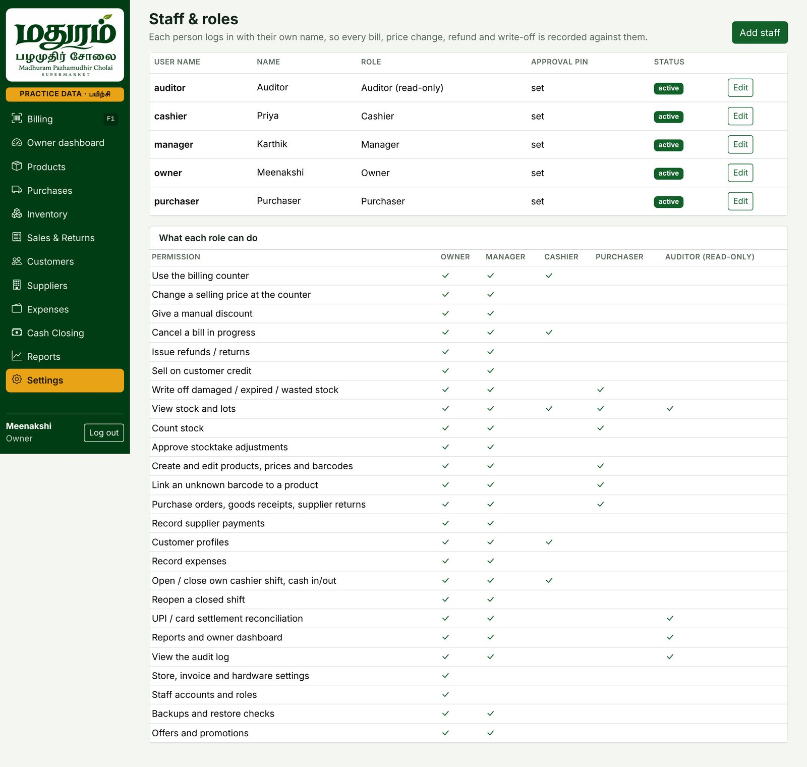

The **Audit log** records price changes, approvals, discounts, refunds, write-offs, cancelled bills, reprints, reopened shifts,
settings changes and every sale.

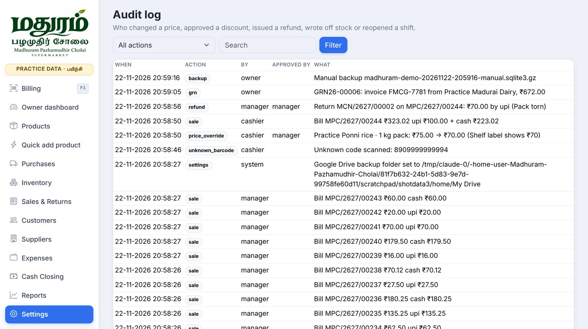
